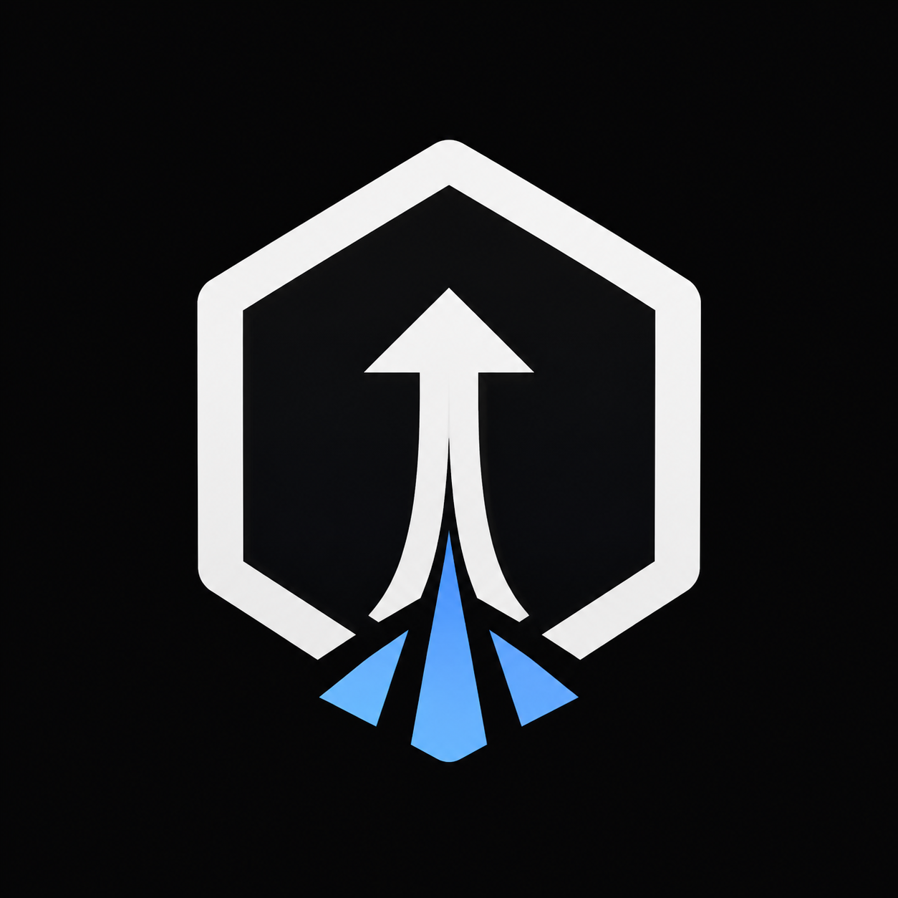

<p align="center">
  
</p>

<h1 align="center">DployGo</h1>

<p align="center">
  An unofficial, mobile-first Flutter console for operating Dokploy from Android and iOS.
</p>

DployGo is designed for common infrastructure tasks from a phone instead of
being a pixel-for-pixel copy of the Dokploy web dashboard. It includes a demo
environment, real Dokploy API integration, secure multi-instance storage,
custom CA support, and mutual-TLS client identities.

The project is under active development. Some screens use real API data while
others remain partial or demo-only. Read the
[implementation status](docs/IMPLEMENTATION_STATUS.md) before working on a
feature or relying on it in production.

## Highlights

- Multiple Dokploy instances with API-key and mTLS authentication
- Custom PEM/P7B CA chains and password-protected PKCS#12 identities
- Projects, applications, Compose stacks, deployments, logs, and servers
- Start, stop, redeploy, deploy, and cancel operations
- Server health and monitoring configuration
- Local deployment notifications and deep links
- Secure credential storage through Keychain and Android secure storage
- Mobile, tablet, dark-theme, and demo-mode support

## Quick start

### Prerequisites

Install the tools needed for the platform you want to develop on:

- Git
- [FVM](https://fvm.app/) for the repository-pinned Flutter SDK
- Android Studio or the Android command-line tools, Android SDK 36, and JDK 17
- macOS, Xcode, and CocoaPods for iOS development

The repository pins Flutter `3.44.1` in `.fvmrc`. Always invoke Flutter and
Dart through `fvm`; plain `flutter` or `dart` may use a different SDK.

### Clone and run

```bash
git clone https://github.com/billnice250/dokploy_mobile.git
cd dokploy_mobile

fvm install
fvm flutter pub get
fvm flutter devices
fvm flutter run
```

The Android and iOS projects are committed to the repository. Do not run
`flutter create .` after cloning: regenerating the project can overwrite native
configuration.

DployGo starts in **Demo Infrastructure** mode, so no server, credentials, or
environment file is needed for local UI development.

To target a specific device:

```bash
fvm flutter run -d <device-id>
```

### Platform notes

- Android uses application ID `it.billnice.apps.dokploy`, minimum SDK 24,
  compile SDK 36, and Java 17.
- The iOS Runner target uses bundle ID `it.billnice.apps.dokploy` and targets
  iOS 15.6 or newer.
- iOS dependencies currently use CocoaPods because
  `flutter_secure_storage` does not yet support the project’s Swift Package
  Manager-only path.
- An iOS simulator cannot exercise every Keychain, Face ID, certificate, or
  notification behavior. Verify security-sensitive changes on a real device.

## Connect to a Dokploy server

1. Create a dedicated, least-privilege API token in Dokploy.
2. Open **Settings → Add Dokploy instance** in DployGo.
3. Enter the HTTPS server URL and API token.
4. If required, select one or more PEM/P7B CA files and a password-protected
   `.p12` or `.pfx` client identity.
5. Select **Test & save**.

The app probes the server, stores secrets in platform-protected storage, and
switches from the demo repository to the real repository. Never commit real
tokens, certificates, private keys, passwords, server exports, or logs that may
contain secrets.

## Project structure

```text
assets/                Shared app branding
android/               Android host project and generated launcher/splash assets
ios/                   iOS host project and generated icon/splash assets
lib/
  core/                 Theme, routing, providers, notifications, shared widgets
  data/                 API transport, compatibility mapping, repositories, storage
  domain/               App-owned models and failures
  screens/              Mobile and tablet feature surfaces
scripts/                Local validation and store-artwork generation
store_assets/           App Store and Play Store artwork and screenshots
test/                   Unit and widget tests
docs/                   Architecture, API, security, UX, roadmap, and release notes
```

The main data flow is:

```text
Flutter UI
   │
   ▼
Riverpod providers
   │
   ▼
DokployRepository
   ├── MockDokployRepository  (demo and development)
   └── RealDokployRepository
             │
             ▼
          DokployApi
```

Widgets must not depend directly on Dokploy endpoint names or response shapes.
Keep HTTP details in `lib/data/dokploy_api.dart`, map external responses in
`lib/data/real_repository.dart`, and expose stable app-owned models through the
repository contract. This boundary is important because Dokploy’s API is
RPC-like and its URLs are not versioned.

See [Architecture](docs/ARCHITECTURE.md) and
[API notes](docs/API_NOTES.md) for the complete design constraints.

## Development workflow

Create a focused branch from the latest `main`:

```bash
git switch main
git pull --ff-only
git switch -c feature/short-description
```

Make the smallest coherent change, add or update tests, and run the project
checks before opening a pull request:

```bash
./scripts/check.sh
```

That script verifies formatting, static analysis, and the complete test suite.
The same checks can be run individually:

```bash
fvm dart format --output=none --set-exit-if-changed lib test
fvm flutter analyze
fvm flutter test
```

Useful build checks are:

```bash
fvm flutter build apk --debug

# macOS only; verifies the iOS device build without signing it
fvm flutter build ios --debug --no-codesign
```

## Contribution guidelines

Contributions are welcome through pull requests.

1. Fork the repository, or create a branch if you have write access.
2. Check the [implementation status](docs/IMPLEMENTATION_STATUS.md) and
   [roadmap](docs/ROADMAP.md) to avoid duplicating work.
3. Keep changes focused; separate unrelated refactors from feature work.
4. Add tests for new behavior, response mapping, regressions, and error cases.
5. Run `./scripts/check.sh` and any relevant Android/iOS build checks.
6. Open a pull request explaining the problem, approach, testing performed,
   and remaining limitations.

For UI changes, include before/after screenshots for each affected phone or
tablet layout. For Dokploy API changes, use sanitized fixtures and document the
server version or observed response shape. Never commit data captured from a
real installation without removing credentials, hostnames, customer data, and
other sensitive values.

### Code expectations

- Use the repository-pinned SDK through FVM.
- Follow `analysis_options.yaml`; Dart code uses single-quoted strings.
- Preserve the UI → provider → repository → transport boundary.
- Keep capability and compatibility handling in the data layer.
- Prefer app-owned domain models over leaking upstream JSON into widgets.
- Treat unavailable API data as unavailable, not as a fabricated zero value.
- Require explicit confirmation for destructive or sensitive operations.
- Update the relevant documentation when behavior or support status changes.

### Tests

The suite contains unit and widget coverage for API transport, defensive
mapping, TLS credential parsing, notification transitions, navigation,
responsive layouts, and sensitive-operation confirmation. Place tests near the
behavioral layer they protect and prefer a regression test when fixing a bug.

Tests must not depend on a live Dokploy server. Use mocked adapters or sanitized
fixtures so the suite remains deterministic and safe to run offline.

## Branding and store artwork

The canonical brand asset is `assets/branding/dokploy-mark.png`. The launcher
icons, splash screens, in-app mark, store icons, feature graphic, documentation,
and saved store screenshots derive from it.

After intentionally replacing the canonical asset, regenerate the platform
artwork:

```bash
fvm dart run flutter_launcher_icons
fvm dart run flutter_native_splash:create

# macOS only; also refreshes the mark in saved store screenshots
swift scripts/generate_store_artwork.swift
```

Review generated images visually at launcher size before committing them.

## Documentation

- [Implementation status](docs/IMPLEMENTATION_STATUS.md) — real, partial, demo,
  and unavailable behavior
- [Architecture](docs/ARCHITECTURE.md) — layers and dependency boundaries
- [API notes](docs/API_NOTES.md) — Dokploy endpoint and compatibility research
- [Security](docs/SECURITY.md) — credential handling and threat model
- [UX](docs/UX.md) — interaction and responsive-layout principles
- [Roadmap](docs/ROADMAP.md) — planned product work
- [Privacy policy](docs/PRIVACY_POLICY.md) — user-facing data practices
- [Release guide](docs/RELEASE.md) — signing and store-delivery setup
- [Push relay](docs/PUSH_RELAY.md) — optional background notification design

## Security

Do not put API keys, CA chains, client identities, certificate passwords, or
private server data in SharedPreferences, source files, logs, analytics, crash
reports, screenshots, issues, or pull requests. Use only platform-protected
storage for secrets and require valid HTTPS by default.

Read [Security](docs/SECURITY.md) before changing authentication, TLS, storage,
notifications, destructive actions, or clipboard behavior.

## Current limitations

Backups, schedules, domains, databases, Compose service inspection, terminal
sessions, background push delivery, and several mobile-native integrations are
partial, demo-only, or planned. The definitive list is maintained in
[Implementation Status](docs/IMPLEMENTATION_STATUS.md).

## License and trademark

DployGo is an independent, unofficial client and is not affiliated with or
endorsed by Dokploy. Follow Dokploy’s trademark requirements and do not present
this project as an official product.

This repository does not currently include a software license. Contributions
may be submitted through GitHub, but do not assume redistribution or reuse
rights until a license is added.
